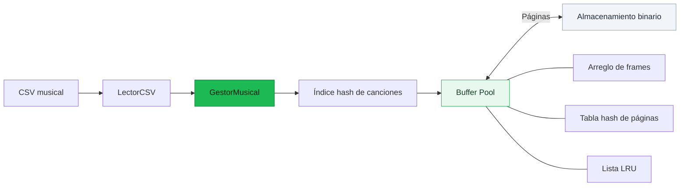

<div align="center">

# 🎧 Spotify Database Manager

### De un dataset musical a nuestro propio gestor de datos.

Un proyecto para aprender a organizar información, administrar páginas en memoria<br>
y construir estructuras de datos propias con **C++17**.


**Estructura de Datos · Ingeniería de Software · Cuarto semestre**

[Estado actual](#estado-actual) · [Compilar y ejecutar](#compilar-y-ejecutar) · [Arquitectura](#arquitectura-general) · [Equipo](#equipo)

</div>

---

> **¿Qué se puede ejecutar hoy?** La versión 0.1 construye los componentes y muestra la presentación del proyecto. Las consultas sobre canciones reales todavía están pendientes.

## El proyecto

**Spotify Database Manager** es la base de un motor sencillo para gestionar información musical. Partimos de un CSV de aproximadamente **900 000 registros** y desarrollaremos progresivamente la lectura, el almacenamiento y las consultas.

El propósito académico es comprender cómo trabajan juntas las estructuras de datos: qué información guarda cada una, cómo se recorre y por qué resulta útil para una operación concreta.

### Objetivo principal

Almacenar y consultar una gran cantidad de canciones **sin cargar todo el dataset simultáneamente en RAM**, mediante lectura incremental, un archivo binario paginado y un buffer de capacidad limitada.

## Estado actual

| Área | Disponible en esta entrega | Pendiente |
| :--- | :--- | :--- |
| **Inicio** | Construcción de componentes y presentación en consola | Menú interactivo |
| **Canciones** | Modelo de los 16 campos y valores opcionales | Lectura y conversión de registros reales |
| **CSV** | Apertura y cierre en modo lectura | Parser incremental y validación de columnas |
| **Almacenamiento** | Apertura de archivos existentes y consulta de su tamaño | Formato binario, serialización y acceso por página |
| **Buffer Pool** | Reserva de frames, tamaños configurables y contadores en cero | Carga de páginas, hits/misses reales y reemplazo |
| **Índices y consultas** | Clases e interfaces preparadas | Algoritmos hash, LRU y operaciones musicales |
| **Construcción** | CMake y compilación con C++17 | Integración de las próximas funcionalidades |

La compilación y el arranque se verificaron con **MSVC**. También se comprobaron con **GCC** los constructores, la apertura de archivos y la señalización de operaciones pendientes.

Las funciones sin implementar lanzan `logic_error` con un mensaje que comienza por `Pendiente:`. Los contadores del buffer aún no representan mediciones de rendimiento.

### Siguiente avance propuesto

Dos funciones pequeñas permitirán demostrar un recorrido completo con datos reales:

- [ ] **`LectorCSV::leerSiguiente()`**: leer una canción por llamada, respetando campos vacíos y textos entre comillas.
- [ ] **`GestorMusical::buscarPorId()`**: recorrer el CSV hasta encontrar el `track_id` solicitado.

La primera búsqueda será **secuencial y provisional**. Más adelante se conectará con la tabla hash y el almacenamiento paginado. Estas dos funciones siguen pendientes en el código actual.

## Características previstas

| Consultar música | Administrar registros | Gestionar memoria |
| :--- | :--- | :--- |
| Buscar por identificador | Insertar canciones | Mantener páginas en RAM |
| Buscar por artista o álbum | Actualizar canciones | Reemplazar páginas mediante LRU |
| Filtrar por año o género | Eliminar canciones | Consultar hits y misses |
| Obtener rankings de popularidad | Importar el CSV por registros | Limitar la cantidad de frames |

Estas características describen el alcance futuro del proyecto.

## Estructuras de datos

| Estructura | ¿Para qué la utilizaremos? | Estado |
| :--- | :--- | :--- |
| **Tabla hash propia** | Localizar la página de una canción por `track_id`; otra instancia localizará el frame de una página | Interfaz preparada |
| **Arreglo de frames** | Reservar los espacios temporales de RAM mediante `vector<Frame>` | Construcción disponible |
| **Lista doblemente enlazada propia** | Mantener el orden de uso de los frames para la política LRU | Interfaz preparada |
| **Páginas** | Agrupar bytes en bloques de almacenamiento identificables | Modelo disponible |
| **Árbol AVL** | Apoyar futuros índices ordenados, según su diseño | Fase posterior |
| **Heap** | Apoyar la obtención de rankings de popularidad | Fase posterior |

Los algoritmos académicos se implementarán de forma propia. La tabla hash y la lista enlazada no se sustituyen con `unordered_map` ni `list`. La STL se utiliza para tareas auxiliares, como textos, arreglos dinámicos y valores opcionales.

## Arquitectura general

El diseño separa el origen de los datos, su almacenamiento permanente y las páginas temporales en memoria. **Este diagrama muestra el funcionamiento previsto**, todavía pendiente de integración:



| Concepto | Significado |
| :--- | :--- |
| **Página** | Bloque lógico con identificador y bytes. Tamaño inicial: **4096 bytes**, configurable. |
| **Frame** | Espacio en RAM que contiene una página y su estado de ocupación. |
| **Buffer Pool** | Conjunto limitado de frames. Capacidad inicial: **16 frames**, configurable. |
| **Almacenamiento** | Archivo permanente que contendrá las páginas cuando se implemente la importación. |

El ID de una página y la posición de un frame son distintos. El frame `2`, por ejemplo, podría contener la página `140`. La capacidad del buffer limita las páginas residentes en RAM; no determina el tamaño del archivo en disco.

📖 Consulta [la guía de arquitectura](docs/arquitectura.md) para estudiar el flujo de una consulta y el reemplazo LRU.

## Organización de carpetas

<details>
<summary><strong>Explorar la estructura del proyecto</strong></summary>

```text
spotify_dbms/
├── include/                    # Modelos y contratos de los componentes
│   ├── Cancion.h
│   ├── Pagina.h
│   ├── Frame.h
│   ├── LectorCSV.h
│   ├── Almacenamiento.h
│   ├── TablaHash.h
│   ├── ListaLRU.h
│   ├── BufferPool.h
│   └── GestorMusical.h
├── src/                        # Implementaciones y punto de entrada
│   ├── main.cpp
│   ├── LectorCSV.cpp
│   ├── Almacenamiento.cpp
│   ├── TablaHash.cpp
│   ├── ListaLRU.cpp
│   ├── BufferPool.cpp
│   └── GestorMusical.cpp
├── data/
│   └── .gitkeep                # Conserva la carpeta para datos locales
├── docs/
│   └── arquitectura.md         # Guía del diseño previsto
├── CMakeLists.txt              # Configuración de compilación
├── .gitignore                  # Exclusión de datos y archivos generados
└── README.md
```

</details>

| Archivos | Responsabilidad |
| :--- | :--- |
| `Cancion.h`, `Pagina.h`, `Frame.h` | Representar los datos y los bloques temporales de memoria |
| `LectorCSV.h` / `.cpp` | Abrir el CSV y preparar su lectura incremental |
| `Almacenamiento.h` / `.cpp` | Administrar el acceso futuro al archivo paginado |
| `TablaHash.h` / `.cpp` | Definir la asociación entre claves y posiciones |
| `ListaLRU.h` / `.cpp` | Definir el registro y la actualización del orden de uso |
| `BufferPool.h` / `.cpp` | Reservar frames y preparar la gestión de páginas |
| `GestorMusical.h` / `.cpp` | Coordinar los componentes y las operaciones musicales |
| `main.cpp` | Inicializar el proyecto y mostrar su presentación |

## Requisitos

- Compilador compatible con **C++17**: MSVC, GCC o Clang.
- **CMake 3.16 o posterior**.
- Herramientas de construcción correspondientes: MSBuild, Make o Ninja.
- Para trabajar en **VS Code**: extensiones **C/C++** y **CMake Tools**.

En Windows, Visual Studio Build Tools debe incluir las herramientas de desarrollo de escritorio con C++. El editor y el compilador se instalan por separado. Esta entrega no necesita bibliotecas externas ni el CSV para mostrar la presentación inicial.

## Compilar y ejecutar

Abre una terminal en la carpeta `spotify_dbms`.

### Windows · PowerShell y Visual Studio Build Tools

```powershell
cmake -S . -B build
cmake --build build --config Debug
.\build\Debug\spotify_dbms.exe
```

Estos comandos utilizan el generador de Visual Studio predeterminado al configurar una carpeta de compilación nueva. Con MinGW o Ninja, el ejecutable suele quedar directamente en `build`.

### Linux o macOS · GCC o Clang y Make

```sh
cmake -S . -B build -DCMAKE_BUILD_TYPE=Debug
cmake --build build
./build/spotify_dbms
```

### Desde Visual Studio Code

1. Abre la carpeta `spotify_dbms`.
2. Ejecuta **CMake: Select a Kit** y selecciona el compilador instalado.
3. Ejecuta **CMake: Configure**.
4. Ejecuta **CMake: Build**.
5. Inicia el ejecutable desde la terminal integrada con el comando de tu plataforma.

<details>
<summary><strong>Ver la salida actual del programa</strong></summary>

```text
========================================
       SPOTIFY DATABASE MANAGER
========================================
Proyecto Final - Estructura de Datos

Version: 0.1
Estado: Scaffold inicializado

Integrantes:
- Esteban Villagarcia
- Fernando Lizarraga
- Leonardo Cuadros

Componentes preparados correctamente.
Interfaz de usuario: proxima version.
========================================
```

</details>

## Dataset

Trabajaremos con **Almost a Million Spotify Tracks**, disponible en [Zenodo](https://zenodo.org/records/11453410).

En el workspace actual, los archivos ya se encuentran en la carpeta superior del repositorio:

```text
ESTRUCTURA DE DATOS/
├── tracks.csv                  # Dataset original
├── spotify_reduced.csv         # Versión reducida existente
└── spotify_dbms/               # Código del proyecto
```

La ruta predeterminada del lector es `../spotify_reduced.csv`, relativa al directorio desde el que se ejecute el programa. El arranque actual no abre este archivo. Los constructores permiten configurar otra ruta para las futuras integraciones.

<details>
<summary><strong>Consultar las 16 columnas del CSV reducido</strong></summary>

| Grupo | Columnas originales |
| :--- | :--- |
| Identificación | `name`, `track_id` |
| Artistas | `track_artists`, `artist_followers`, `artist_popularity` |
| Álbum | `album_name`, `album_release_date`, `track_track_number`, `album_total_tracks`, `track_album_album` |
| Información musical | `duration_ms`, `genres`, `explicit`, `tempo` |
| Popularidad y reproducciones | `popularity`, `streams` |

`LectorCSV::COLUMNAS_ESPERADAS` conserva los nombres y el orden del encabezado original. En `Cancion`, el campo `explicit` se llama `es_explicita` porque `explicit` es una palabra reservada de C++.

Los campos numéricos y el indicador explícito usan `optional` para distinguir un valor ausente de un cero o un falso. El parser deberá validar formatos y rangos, incluidos enteros escritos con sufijo `.0`, y respetar comillas, comas y posibles saltos de línea dentro de un campo. Estas conversiones siguen pendientes.

</details>

Los CSV permanecen en su ubicación original y están excluidos de Git, al igual que los binarios y las compilaciones. `data/canciones.bin` es la ruta prevista para el almacenamiento futuro: esta versión no crea ese archivo.

## Ruta de desarrollo

| Etapa | Entregable | Estado |
| :--- | :--- | :--- |
| **0.1 · Base del proyecto** | Modelos, clases, CMake, presentación y documentación | Disponible |
| **Próximo avance funcional** | Lectura de una canción y búsqueda secuencial por ID | Propuesto |
| **Versión 2 · Interfaz** | Menú de consola y presentación visual | Planificado |
| **Almacenamiento e índices** | Importación, páginas binarias, hash propio y Buffer Pool con LRU | Pendiente |
| **Consultas y rankings** | Operaciones musicales, índices AVL y Heap según su diseño | Fase posterior |

El equipo definirá el orden detallado de las fases posteriores. Cada avance deberá poder compilarse, explicarse y verificarse con datos reales.

### Convenciones del equipo

C++17, nombres claros, comentarios útiles en español y separación entre `.h` y `.cpp`. Utilizamos **`using namespace std;`** en los archivos C++ por acuerdo del equipo. Priorizamos código sencillo y modular que podamos entender y explicar durante la exposición.

## Equipo

| Integrante | Programa académico |
| :--- | :--- |
| **Esteban Villagarcia** | Ingeniería de Software · Cuarto semestre |
| **Fernando Lizarraga** | Ingeniería de Software · Cuarto semestre |
| **Leonardo Cuadros** | Ingeniería de Software · Cuarto semestre |

---

<div align="center">

**Proyecto final · Estructura de Datos**<br>
Construido paso a paso, con estructuras que podamos entender y explicar.

</div>
