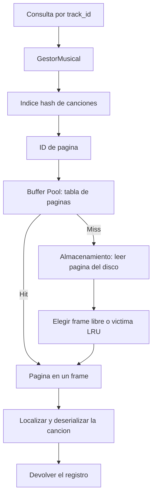

# Arquitectura de Spotify Database Manager

Esta guía describe cómo **funcionará** el sistema. En la versión 0.1 existen los modelos, los constructores y las interfaces; los algoritmos de importación, consulta y reemplazo siguen pendientes.

## Del CSV al almacenamiento permanente

El CSV es la fuente de datos. El futuro `LectorCSV` leerá una canción por llamada y validará los 16 campos originales, sin reunir el archivo entero en memoria. Por ahora únicamente permite abrir y cerrar el archivo en modo lectura.

Durante una futura importación, `GestorMusical` coordinará la conversión de cada registro a bytes. Estos bytes se agruparán en páginas y `Almacenamiento` las escribirá en un archivo binario. Antes de programarlo hay que definir la serialización de textos de longitud variable, los límites de página y el tratamiento de registros que no quepan. No se debe escribir directamente la memoria de `Cancion`: contiene `std::string` y `std::optional`, cuya representación en RAM no es un formato persistente.

El archivo permanecerá en disco al cerrar el programa. Esta entrega no lo crea: `Almacenamiento::abrir()` solo intenta abrir un archivo ya existente, sin truncarlo. La creación de páginas ocurrirá durante la importación, no durante la compilación ni el arranque.

## Página y frame

- Una **página** es un bloque lógico con identificador y bytes. Su tamaño predeterminado es de 4096 bytes y se puede configurar. La cantidad de canciones por página dependerá de la serialización.
- Un **frame** es un espacio del buffer en RAM que puede contener una página. Tiene su propia posición en el arreglo de frames y un indicador `ocupado`. El ID de la página se guarda en `frame.pagina.id`; no se duplica en otro atributo.

El frame número 2 podría contener la página número 140. Esos identificadores representan cosas diferentes. En un frame libre, el ID inicial de su página no identifica un contenido válido; debe consultarse `ocupado`.

## Buffer Pool y memoria RAM

`BufferPool` reserva un `std::vector<Frame>` con capacidad configurable: inicialmente 16 frames. Cada frame reserva un bloque de bytes del tamaño configurado. Los 16 bloques de 4096 bytes suman 65 536 bytes de datos, además de los metadatos y del costo de los contenedores. Esta capacidad limita las páginas residentes, no el tamaño del archivo en disco.

En el diseño futuro, si una página ya está en el buffer habrá un **hit**. Si debe recuperarse del disco habrá un **miss**. Los contadores existen, pero permanecen en cero porque `obtenerPagina` todavía no hace accesos. El almacenamiento y el buffer reciben el mismo tamaño de página al construir `GestorMusical`.

RAM es memoria temporal: al finalizar el programa se pierden los frames. El archivo binario será la copia permanente. La política para guardar cambios en páginas y evitar pérdidas al reemplazarlas debe definirse antes de implementar modificaciones de registros.

## Dos usos de la tabla hash

Se prepararon dos instancias independientes de `TablaHash`:

| Instancia | Clave prevista | Posición asociada |
| --- | --- | --- |
| Índice de canciones en `GestorMusical` | `track_id` | ID de la página que contiene la canción |
| Tabla de páginas en `BufferPool` | ID de página convertido a texto | Índice del frame que contiene esa página |

La interfaz sencilla asocia `std::string` con `std::size_t`. No contiene aún entradas ni un algoritmo de dispersión. La función hash, las colisiones y las reglas para claves repetidas se diseñarán después. Inicialmente el índice de canciones ubicará la página; habrá que localizar el registro dentro de ella. Un desplazamiento directo podría añadirse cuando se diseñe el formato binario.

## Reemplazo LRU previsto

La futura lista doblemente enlazada guardará índices de frames, con enlaces al anterior y al siguiente. Un extremo representará el uso más reciente y el otro el menos reciente.

Al utilizar una página, su frame se registrará o moverá al extremo más reciente. Si el buffer está lleno y debe entrar otra página, se seleccionará el frame del extremo menos reciente para reemplazarlo. Antes de reutilizarlo habrá que preservar los cambios que corresponda y actualizar la tabla de páginas. Los nodos, enlaces y movimientos están pendientes; no se usa `std::list` como sustituto.

## Flujo futuro de una consulta por ID

1. El gestor buscará `track_id` en el índice. Si no existe, devolverá ausencia de resultado.
2. Con el ID de página, solicitará esa página al buffer.
3. El buffer consultará su tabla para saber si la página ya reside en RAM.
4. Si falta, la pedirá al almacenamiento y utilizará un frame libre o aplicará LRU.
5. Actualizará sus metadatos y estadísticas; el gestor localizará y deserializará la canción.

Estas flechas describen el flujo previsto; en 0.1 las consultas lanzan `std::logic_error` con un mensaje de operación pendiente. No hay consultas exitosas simuladas.

## Responsabilidad de la siguiente fase

Definir primero el formato binario y la lectura incremental permitirá conectar las estructuras con datos reales. Las búsquedas por artista, álbum, año y género necesitarán decidir qué índices o recorridos utilizar y cómo limitar la memoria ocupada por sus resultados. AVL y Heap se incorporarán solo cuando se diseñen esos índices y los rankings. La interfaz de consola corresponde a la versión 2.
